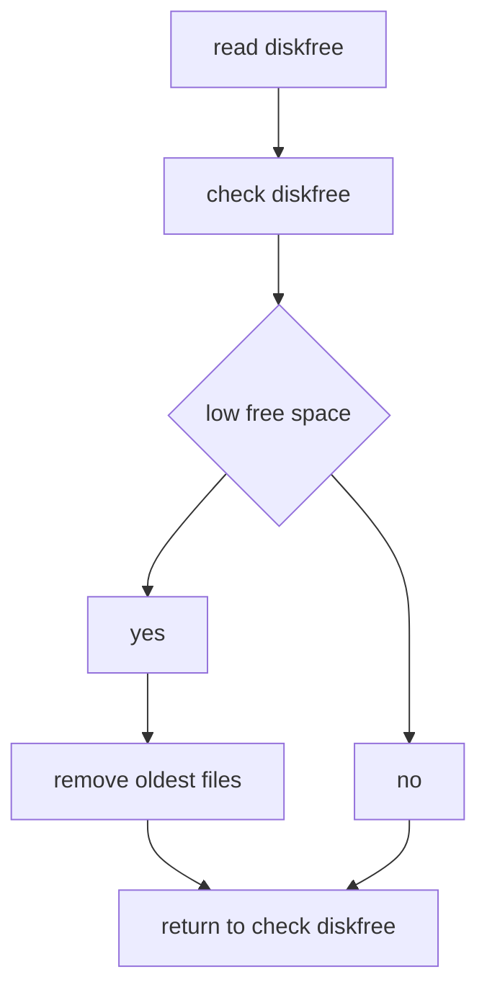
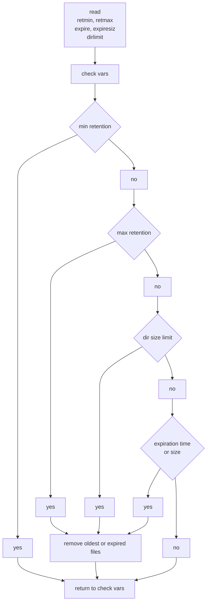
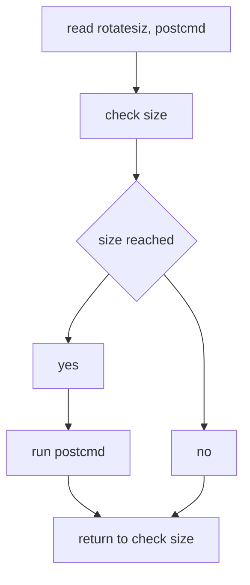
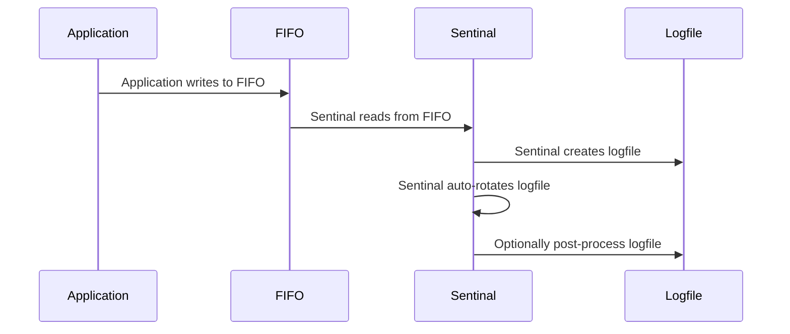

# sentinal: Software for Logfile and Inode Management

System and application processes can create many files and large files,
possibly causing disk partitions to run out of space. **sentinal** is a systemd
service for managing files and filesystems to comply with the directives in
an INI configuration file. Depending on your goals, sentinal can also act as
an adjunct or an alternative to logrotate.

**Monitoring and management capabilities:**

- Available filesystem disk space by percentage
- Available filesystem inode usage by percentage or count
- Expire files by size, age, or retention settings
- Inodes by age or retention settings
- Log ingestion, processing, and rotation
- Monitor and process log files when they reach a given size

Additional documentation lives in `README.d/`:
`README.d/README.inifile.md` covers key semantics and token expansion,
`README.d/README.threads` shows minimal thread-specific INI stanzas,
`README.d/README.fifo` explains FIFO behavior and `sentinalpipe`,
and `README.d/README.pcretest.md` includes PCRE examples.

## Contents

- [Quick Start](#quick-start)
- [Usage](#usage)
- [Configuration](#configuration)
- [Examples by Task](#free-disk-space)
- [Systemd Unit File](#systemd-unit-file)
- [Build and Install](#build-and-install)
- [Test INI Files](#test-ini-files)
- [Utilities](#utilities)
- [Run](#run)
- [Troubleshooting](#troubleshooting)
- [Notes](#notes)

## Quick Start

This example keeps `/var/log/myapp` from growing without bound: it removes
files older than 14 days, but always keeps at least the 3 newest.

1. Build and install (see [Build and Install](#build-and-install)).
2. Create `/opt/sentinal/etc/myapp.ini`:

   ```ini
   [global]
   pidfile   = /run/myapp-sentinal.pid
   database  = :memory:

   [myapp]
   dirname   = /var/log/myapp
   pcrestr   = ^myapp\.log
   expire    = 14D
   retmin    = 3
   ```

3. Make the file root-owned and not writable by others. sentinal refuses to
   start otherwise (see [INI File Ownership and Permissions](#ini-file-ownership-and-permissions)):

   ```shell
   # chown root:root /opt/sentinal/etc/myapp.ini
   # chmod 0644 /opt/sentinal/etc/myapp.ini
   ```

4. Check which threads sentinal will run. A section that starts no threads
   does nothing, usually because a required key is missing:

   ```shell
   # /opt/sentinal/bin/sentinal -f myapp.ini -v
   ...
   # threads   dfs: false   exp: true   slm: false   wrk: false
   ```

5. Rehearse without removing anything, then run for real:

   ```shell
   # /opt/sentinal/bin/sentinal -f myapp.ini -D
   # systemctl enable --now sentinal
   ```

   A dry run prints the `postcmd` it would run and does not start log-ingestion
   (`wrk`) threads. Stop the dry run with Ctrl-C. A dry run does not create the pid file, uses
   an in-memory database, and reports a limited number of would-be removals.
   Review its log output before enabling the service.

## Usage

```txt
Usage: sentinal -f ini-file [-dsDvV]
 -f, --ini-file   INI file, full path or relative to /opt/sentinal/etc
 -d, --debug      print the INI file, exit
 -s, --split      print the INI file with split sections, exit
 -D, --dry-run    don't remove anything
 -v, --verbose    print the INI file as interpreted, exit
 -V, --version    print version number, exit
 -?, --help       this message
```

## Configuration

sentinal uses INI files for its runtime configuration. Each section in the
INI file pertains to one resource: a directory, possibly a file template,
and the conditions for managing the resource.

### INI File Ownership and Permissions

The INI file determines which commands sentinal runs, and as which user, so
sentinal validates it before loading it. Both `sentinal` and `sentinalpipe`
refuse to start unless the INI file:

- is a regular file (not a symlink, FIFO, or device),
- is owned by `root` or by the user running sentinal, and
- has permissions no broader than `0644` (no group or other write, no
  execute or set-id bits).

### INI File Description

An INI file must contain a section called `global` and one to 32 other
sections. Lines starting with `;` are comments, and lines without an `=` are
ignored. The `global` section must
include a `pidfile` definition and may include a `SQLite3` database
definition. The database name can be `:memory:`, or a pathname of a disk file.

Section names must be unique in the INI file. For valid SQLite table names,
start them with a letter and use only alphanumeric or underscore characters.
For untruncated thread names and split-section output, keep section names to
11 characters or fewer.

**\[global\]**

- `pidfile`: sentinal process ID and lock file, absolute path, required
- `database`: name of the SQLite3 database, `:memory:` or file path,
  default `:memory:`

**\[section\]**

- `command`: command to run, absolute path
- `dirname`: thread and postcmd working directory, absolute path, required
- `dirlimit`: maximum total size of matching files in a directory,
  binary (KiB) or decimal (KB) units, 0 = no max (off)
- `subdirs`: option to search subdirectories for matching files (true)
- `pipename`: named pipe/fifo file, full path or relative to dirname
- `template`: output file name, date(1) sequences %F %Y %m %d %H %M %S %s
- `pcrestr`: perl-compatible regex naming files to manage; matches anywhere
  in the file name unless anchored with `^` or `$`
- `uid`: username or uid for command/postcmd, default = nobody
- `gid`: groupname or gid for command/postcmd, default = nogroup
- `rotatesiz`: size in binary or decimal units, 0 = no rotate
- `expiresiz`: size in binary or decimal units, 0 = no expiration by size
- `diskfree`: percent blocks free, 0 = no monitor (off)
- `inofree`: percent inodes free, 0 = no monitor (off)
- `expire`: file retention time, units = m, H, D, W, M, Y, default unit = D,
  0 = no expiration (off)
- `retmin`: minimum number of files to retain, 0 = none (off)
- `retmax`: maximum number of files to retain, 0 = no max (off)
- `terse`: option to record or suppress file removal notices (false)
- `rmdir`: option to remove empty directories (false)
- `symlinks`: option to follow symlinks to files (false)
- `postcmd`: command to run after log closes or rotates;
  tokens: `%file`, `%host`, `%path`, `%sect`
- `truncate`: option to truncate slm-managed files (false)

Flags (`subdirs`, `terse`, `rmdir`, `symlinks`, `truncate`) accept `true` or `1`
for on; anything else is off.

#### Sizes and Counts

Sizes in bytes or files may be given in binary (IEC) units {K,M,G,T}i{B,F} or decimal (SI) units {K,M,G,T}{B,F},
or no units (literal value). Examples,
1KB = 1000 bytes, 1K or 1KiB = 1024 bytes.
1MF = 1000000 files, 1M or 1MiF = 1048576 files.

A bare `M` or `G` is binary (1024-based), so `rotatesiz = 50M` is 50MiB.

| Unit | Value (Base 2) |
| :--- | :------------- |
| KiB  | 2^10           |
| MiB  | 2^20           |
| GiB  | 2^30           |
| TiB  | 2^40           |
| PiB  | 2^50           |
| EiB  | 2^60           |

| Unit | Value (Base 10) |
| :--- | :-------------- |
| KB   | 10^3            |
| MB   | 10^6            |
| GB   | 10^9            |
| TB   | 10^12           |
| PB   | 10^15           |
| EB   | 10^18           |

#### Time Units

Time units apply to `expire`. A number with no unit means days.

| Unit | Time    | Notes                               |
| :--- | :------ | :---------------------------------- |
| m    | minutes | lowercase only; `M` means months    |
| H    | hours   | `h` also accepted                   |
| D    | days    | `d` also accepted; the default unit |
| W    | weeks   | `w` also accepted                   |
| M    | months  | uppercase only; `m` means minutes   |
| Y    | years   | `y` also accepted                   |

A month is 30 days and a year is 365 days; they are not calendar units.
Write `m` and `M` carefully: `expire = 2m` is two minutes, `expire = 2M` is
two months.

### Which Threads Does a Section Start?

sentinal decides what to do with each section from the keys it contains. One
section can start several threads. For example, a section with `command`,
`pipename`, `template`, and `retmax` starts both a log-ingestion thread and a
file-expiration thread. Run `sentinal -f file.ini -v` to see the `# threads`
line for each section.

| Thread | Name suffix | Starts when the section has                                  |
| :----- | :---------- | :----------------------------------------------------------- |
| DFS    | `_dfs`      | `pcrestr` and at least one of `diskfree`, `inofree`          |
| EXP    | `_exp`      | `pcrestr` and at least one of `dirlimit`, `expire`, `retmax` |
| SLM    | `_slm`      | no `command`; `template`, `postcmd`, and `rotatesiz`         |
| WRK    | `_wrk`      | `command`, `pipename`, and `template`                        |

`retmin` and `expiresiz` never start a thread alone; they modify DFS and EXP
threads. `expiresiz` without `expire` does nothing, and sentinal logs a
warning.

#### Diskfree (DFS) Thread

- `pcrestr`
- One or more of the following:
  - `diskfree`
  - `inofree`
- Optional, strongly recommended:
  - `retmin`: without it, a full disk can cause every matching file to be
    removed, and sentinal logs a notice

#### Expire (EXP) Thread

- `pcrestr`
- One or more of the following:
  - `dirlimit`
  - `expire`
  - `retmax`
- Optional:
  - `retmin`
  - `expiresiz`

#### Simple Log Monitor (SLM) Thread

- `command` unset (null)
- `template`
- `postcmd`
- `rotatesiz`
- Optional, likely required by use case:
  - `uid`
  - `gid`

#### Work (log ingestion, WRK) Thread

- `command`
- `pipename`
- `template`
- Optional, but recommended:
  - `rotatesiz`
- Optional:
  - `postcmd`
- Optional, likely required by use case:
  - `uid`
  - `gid`

Add `pcrestr` plus `expire`, `retmax`, `dirlimit`, `diskfree`, or `inofree` to
a WRK section to also clean up the logs it creates.

### Key Behavior

- If `command` is set, `template` must be set.
- If `rotatesiz` is set, rotate the file after it reaches the specified size.
- If `expiresiz` is set, remove files larger than the specified size
  at expiration time.
- If `diskfree` is set, create a thread to discard the oldest files
  to free disk space.
- If `inofree` is set, create a thread to discard the oldest files to free inodes.
- If `expire` is set, remove files older than the expiration time.
- If `retmin` is set, retain `n` number of files, regardless of
  expiration or available disk space.
- If `retmax` is set, retain a maximum number of `n` files, regardless of expiration.
  If `retmax` is less than `retmin`, sentinal logs a warning and sets
  `retmax` to 0 (off) so that nothing is lost.
- If `postcmd` is specified, the value is passed as a command to
  `bash -c` after the file closes or rotates. (Optional.)

#### Precedence of Keys

- `retmin`, `retmax` take precedence over `dirlimit`, `diskfree`, `inofree`, `expire`.
- `dirlimit`, `diskfree`, `inofree` take precedence over `expire`.

In other words, `retmin` is a floor that nothing else can breach, even when the
disk is full.

### Free Disk Space

sentinal can remove files when the filesystem they occupy falls below
the free space constraint.



**Diskfree example:** To keep 20% of the filesystem free by removing the
oldest `console` logs in `/opt/sentinal/log`, while always keeping the five
newest:

```ini
[global]
pidfile   = /run/diskfree.pid
database  = :memory:

[console]
dirname   = /opt/sentinal/log
diskfree  = 20
retmin    = 5
pcrestr   = ^console
```

The free-space figure is for unprivileged users and is measured on the
filesystem that holds `dirname`, but only files matching `pcrestr` are removed.

**Inode example:** To keep 10% of inodes free in a directory of many small
files, removing the oldest first and keeping at least 100:

```ini
[global]
pidfile   = /run/spool.pid
database  = :memory:

[spool]
dirname   = /var/spool/myapp
inofree   = 10
retmin    = 100
pcrestr   = \.msg$
rmdir     = true
```

### File Expiration

sentinal can remove files when they meet one or more of the following
constraints: `retmin`, `retmax`, `expire`, `expiresiz`, `dirlimit`.

The combinations of `expire` and `expiresiz` settings affect
expiration behavior. If:

- `expire` is set and `expiresiz` is unset, remove files older than
  the expiration time.
- Both `expire` and `expiresiz` are set, remove files that are **both**
  older than the expiration time **and** larger than `expiresiz`.
- `expiresiz` is set and `expire` is unset, take no action.



**Expiration example:** This INI configuration removes gzipped files
in `/var/log` and its subdirectories after two weeks:

```ini
[global]
pidfile   = /run/varlog.pid
database  = :memory:

[zipped]
dirname   = /var/log
expire    = 2W
pcrestr   = \.gz$
subdirs   = true
```

**Expiration example (time and size):** This INI uses two threads to remove
compressed files in `/sandbox`. The `sandbox2M` section removes compressed
files aged two months or older, whatever their size. The `sandbox1M` section
removes only compressed files that are aged one month or older **and** larger
than 10GiB, so small files get the longer two-month life. Removals are logged
because `terse` is false.

```ini
[global]
pidfile   = /run/sandbox.pid
database  = :memory:

[sandbox2M]
dirname   = /sandbox
expire    = 2M
pcrestr   = \.(bz2|gz|lz|zip|zst)$
subdirs   = true

[sandbox1M]
dirname   = /sandbox
expiresiz = 10G
expire    = 1M
pcrestr   = \.(bz2|gz|lz|zip|zst)$
subdirs   = true
terse     = false
```

**Directory usage example:** Remove `myapp` logs matching
`myapplog-\d{8}$` when they consume more than 500MiB of disk space
or the number of logs exceeds 21. The oldest files go first, and the
three newest always stay:

```ini
[global]
pidfile   = /run/myapplog.pid
database  = :memory:

[myapp]
dirname   = /var/log/myapp
dirlimit  = 500M
pcrestr   = myapplog-\d{8}$
retmax    = 21
retmin    = 3
```

### Simple Log Monitor

sentinal, using inotify, can monitor and process logs when they reach
a specified size. A sentinal section for SLM must **not** set
`command`. The keys `template`, `postcmd`, and `rotatesiz` must be set.



In this example, sentinal runs logrotate on `chattyapp.log` when the
log exceeds 50MiB in size:

```ini
[global]
pidfile   = /run/chattyapp.pid
database  = :memory:

[chattyapp]
dirname   = /var/log
uid       = root
gid       = root
postcmd   = /usr/sbin/logrotate -f /opt/sentinal/etc/chattyapp.conf
rotatesiz = 50M
template  = chattyapp.log
```

This example is the same as above, adding a 20% diskfree check for
the rotated logs. `pcrestr` matches only rotated copies such as
`chattyapp.log.1`, so the live log is never removed, and `retmin` keeps the
three newest copies even when space is short:

```ini
[global]
pidfile   = /run/chattyapp.pid
database  = :memory:

[chattyapp]
dirname   = /var/log
diskfree  = 20
retmin    = 3
uid       = root
gid       = root
pcrestr   = ^chattyapp\.log\.\d
postcmd   = /usr/sbin/logrotate -f /opt/sentinal/etc/chattyapp.conf
rotatesiz = 50M
template  = chattyapp.log
```

### Logfile Ingestion and Processing

sentinal can ingest and process logs, rotate them on demand or when they reach a
specified size, and optionally post-process logs after rotation. For logfile processing,
replace the application's logfile with a FIFO, and set sentinal to read from it.



Setup, in order:

1. Create the FIFO where the application expects its logfile. The application's
   user must be able to write to it, and sentinal's `uid`/`gid` must be able to
   read it:

   ```shell
   # mkfifo -m 0600 /var/log/example.log
   # chown appowner:appgroup /var/log/example.log
   ```

   If the application's user differs from the user running `command`, adjust
   the owner and mode accordingly. The key `pipename` is relative to `dirname`
   unless it is an absolute path.

2. Add the section below to a complete INI file (a `[global]` section is
   required).
3. If the writer must keep the FIFO open across sentinal restarts, also run
   `sentinalpipe -f` with the same INI file so a reader always exists. See
   `README.d/README.fifo`.
4. Start sentinal before, or together with, the application. A writer blocks
   when nothing is reading the FIFO.

The examples show the per-section stanza only.

For example, this configuration connects the `dd` program to `example.log` for log
ingestion, rotates the log when it reaches 5GiB in size, compresses each
rotated log, and removes compressed logs after 30 days while keeping the
newest ten:

```ini
[example]
dirname   = /var/log
command   = /bin/dd bs=64K status=none
uid       = appowner
gid       = appgroup
pcrestr   = ^example-
pipename  = example.log
postcmd   = /usr/bin/zstd --rm %file 2>/dev/null
rotatesiz = 5G
template  = example-%Y-%m-%d_%H-%M-%S.log
expire    = 30D
retmin    = 10
```

This example does the same as above, but with inline compression
(no intermediate files), and rotates the compressed log when it
reaches 1GiB in size:

```ini
[example]
dirname   = /var/log
command   = /usr/bin/zstd
uid       = appowner
gid       = appgroup
pcrestr   = ^example-
pipename  = example.log
rotatesiz = 1G
template  = example-%Y-%m-%d_%H-%M-%S.log.zst
expire    = 30D
retmin    = 10
```

The `postcmd` tokens `%file`, `%host`, `%path`, and `%sect` are shell-quoted
when expanded, so do not wrap them in quotes yourself. This example writes a
syslog line with the host, section, and file name whenever a log closes:

```ini
[example]
dirname   = /var/log
command   = /bin/dd bs=64K status=none
uid       = appowner
gid       = appgroup
pipename  = example.log
postcmd   = /usr/bin/logger -t sentinal %host %sect closed %file
rotatesiz = 1G
template  = example-%Y-%m-%d_%H-%M-%S.log
```

### Systemd Unit File

sentinal runs as a systemd service. `make systemd` installs example
`sentinal.service` and `sentinalpipe.service` files built from
`services/`. The following is the example unit file:

```ini
[Unit]
Description=sentinal service for /opt/sentinal/etc/example.ini
StartLimitIntervalSec=30
StartLimitBurst=10

[Service]
Type=simple
Nice=10
Restart=on-failure
RestartSec=5
# Use root only when a single sentinal instance must monitor across users.
User=sentinal
ExecStart=/opt/sentinal/bin/sentinal -f /opt/sentinal/etc/example.ini
ExecReload=/bin/kill -s HUP $MAINPID

[Install]
WantedBy=multi-user.target
```

Edit `Description`, `User`, and the INI file path for your site. Create one unit
per INI file, since each INI file runs one sentinal process (and needs its own
`pidfile`).

### User/Group ID Notes

- User/Group ID applies only to `command` and `postcmd`; otherwise,
  sentinal runs as the calling user.
- If an application never needs root privileges to run and process
  logs, consider setting and using the application's user and group
  IDs in the unit file.
- Running sentinal as root is likely necessary when a single sentinal
  instance monitors several different applications.
- When unspecified, the user and group IDs are set to `nobody` and `nogroup`.
- The user running sentinal must be able to read `dirname` and remove files
  from it; `command` and `postcmd` run as `uid`/`gid` and must be able to write
  there.

### Exported Environment Variables

sentinal exports the following variables to `command` and `postcmd`:

- `HOME`: home of uid, default `/tmp`
- `PATH`: `/usr/bin:/usr/sbin:/bin`
- `SHELL`: `/bin/bash`
- `PWD`: `dirname` value from INI file (set implicitly via `chdir`)
- `TEMPLATE`: `template` value from INI file
- `PCRESTR`: `pcrestr` value from INI file

## Build and Install

sentinal requires PCRE2 and SQLite3 development headers/libraries for building
the software (for example, `libpcre2-dev` and `libsqlite3-dev` on Debian, or
`pcre2-devel` and `sqlite-devel` on Red Hat). A default build produces
`sentinal`, `sentinalpipe`, `dfree`, `pcrefind`, and `pcretest`.

```shell
$ cd sentinal
$ make
# make install
```

`make install` installs to `/opt/sentinal/{bin,etc,doc}`, including the example
INI files. `make deb` and `make rpm` build packages.

Install example `sentinal.service` and `sentinalpipe.service` unit files as a
starting point:

```shell
# make systemd
```

Run `make tests` to run the regression tests (no root needed). Edit
`/etc/systemd/system/sentinal.service` as necessary, then:

```shell
# systemctl daemon-reload
```

## Test INI Files

Before starting the service, check every INI file. sentinal provides these
options:

- `-v` or `--verbose` prints INI file sections with the keys evaluated
  as they would be at runtime, including symlink resolution and
  relative-to-full pathname conversion, and shows which threads each
  section will start. **Start here.**
- `-d` or `--debug` prints INI file sections as parsed, resembling the input.
- `-s` or `--split` prints the INI file with thread-specific split sections.
- `-D` or `--dry-run` runs the threads but removes nothing, prints but does not
  run each `postcmd`, and does not start log-ingestion (wrk) threads. Use it to see what
  sentinal would remove.

Sample `-v` output:

```shell
$ /opt/sentinal/bin/sentinal -f example2.ini -v
# /opt/sentinal/etc/example2.ini

[global]
pidfile   = /tmp/example2.pid
database  = /dev/shm/example2.db

[example2]
dirname   = /opt/sentinal/tests
command   = /usr/bin/zstd -T4
#           zstd -f -T4 > /opt/sentinal/tests/example2-2026-10-16_00-40-41.log.zst
diskfree  = 85.00
expire    = 0m
uid       = 1000
gid       = 100
pcrestr   = example2-
pipename  = /opt/sentinal/tests/example2.fifo
retmax    = 25
retmin    = 3
rotatesiz = 1G
subdirs   = 1
template  = example2-%Y-%m-%d_%H-%M-%S.log.zst
#           example2-2026-10-16_00-40-41.log.zst
# threads   dfs: true   exp: true   slm: false   wrk: true
```

The `uid` and `gid` values are resolved to numbers; yours will differ.

If every flag in the `# threads` line is `false`, the section does nothing.
Compare its keys with [Which Threads Does a Section Start?](#which-threads-does-a-section-start).

## Utilities

The build also produces these helper programs, installed in `/opt/sentinal/bin`.

### dfree

`dfree` prints filesystem usage like `df -h`, with two decimal places. Use it
to see the same numbers sentinal sees when you choose `diskfree` values.

```txt
Usage: dfree [mount_point1] [mount_point2] ...
```

With no arguments it lists all mounted filesystems of type btrfs, cifs, exfat,
ext2/3/4, nfs\*, ntfs, ntfs3, vfat, xfs, or zfs, skipping `/proc`, loop devices,
and snap mounts. With arguments it shows the filesystem that holds each path,
once, whatever the number of paths on it. Unresolvable paths and unsupported
filesystem types produce a warning on stderr.

```shell
$ dfree / /work
Filesystem                             Size      Used     Avail    Use% Mounted on
/dev/mapper/vgubuntu--mate-root     225.78G    80.43G   133.81G  37.54% /
/dev/nvme0n1p1                      457.38G    24.74G   409.33G   5.70% /work
```

`Use%` is calculated as `df` does: used / (used + avail), where `Avail` is the
space available to unprivileged users. sentinal's `diskfree` compares
`Avail` / `Size` (blocks available to unprivileged users over total blocks)
against its setting, so on filesystems with reserved blocks, `diskfree = 20`
is slightly stricter than "80% used" in `Use%`.

### pcrefind and pcretest

sentinal matches `pcrestr` against the file **name** only (not the directory
path) and does not anchor the pattern unless you do. Check a pattern before
you rely on it:

```shell
$ pcretest '^example-.*\.zst$' example-2026-01-01.log.zst example.log
match:    example-2026-01-01.log.zst
no match: example.log
$ pcrefind -f '\.gz$' /var/log
```

`pcretest <pcre> <string> ...` reports whether each string matches.
`pcrefind [-f|--files|-d|--dirs] <pcre> <dir> ...` lists matching files or
directories under the given directories. See `README.d/README.pcretest.md` for
more patterns.

### sentinalpipe

`sentinalpipe -f ini-file` holds the FIFOs named in an INI file open for reading
so writers do not get SIGPIPE while sentinal restarts. See `README.d/README.fifo`.

### pcre2.so

`make` also builds `pcre2.so`, a SQLite extension that adds the `REGEXP`
operator using PCRE2. sentinal does not load it; it is provided so you can try
the same patterns in SQLite independently (for example, with
`sqlite3 ... ".load ./pcre2"`) and is not installed by `make install`.

## Run

```shell
# systemctl enable sentinal
# systemctl start sentinal
# systemctl status sentinal
```

Example status output for `example2.ini`:

<!-- markdownlint-disable MD013 -->

```shell
# systemctl status sentinal
* sentinal.service - sentinal service for example2.ini
     Loaded: loaded (/etc/systemd/system/sentinal.service; enabled; preset: enabled)
     Active: active (running) since Wed 2021-11-24 13:01:47 PST; 4s ago
   Main PID: 13580 (sentinal)
      Tasks: 4 (limit: 76930)
     Memory: 852.0K
     CGroup: /system.slice/sentinal.service
             `-13580 /opt/sentinal/bin/sentinal -f /opt/sentinal/etc/example2.ini

Nov 24 13:01:47 loghost sentinal[13580]: example2: start dfs thread: /opt/sentinal/tests
Nov 24 13:01:47 loghost sentinal[13580]: example2: monitor disk: / for 85.00% free
Nov 24 13:01:47 loghost sentinal[13580]: example2: monitor file: example2- for retmin 3
Nov 24 13:01:47 loghost sentinal[13580]: example2: /opt/sentinal/tests: 87.06% blocks free
Nov 24 13:01:47 loghost sentinal[13580]: example2: start exp thread: /opt/sentinal/tests
Nov 24 13:01:47 loghost sentinal[13580]: example2: monitor file: example2- for retmin 3
Nov 24 13:01:47 loghost sentinal[13580]: example2: monitor file: example2- for retmax 25
Nov 24 13:01:47 loghost sentinal[13580]: example2: start wrk thread: /opt/sentinal/tests
Nov 24 13:01:47 loghost sentinal[13580]: example2: command: /usr/bin/zstd -T4
Nov 24 13:01:47 loghost sentinal[13580]: example2: monitor file: example2- for size 1024MiB

(In this example, /opt is in the / filesystem)
```

<!-- markdownlint-enable MD013 -->

Each section reports one `start ... thread` line per thread it started. A
section with no such line did not start; see [Troubleshooting](#troubleshooting).

Useful commands for monitoring sentinal:

```shell
# journalctl -f -n 20 -t sentinal
# journalctl -f -u sentinal
$ ps -lT -p $(pidof sentinal)
$ top -H -S -p $(echo $(pgrep sentinal) | sed 's/ /,/g')
$ htop -d 5 -p $(echo $(pgrep sentinal) | sed 's/ /,/g')
# lslocks -p $(pidof sentinal)
# pmap -X $(pidof sentinal)
```

Examples of on-demand log rotation:

```shell
# systemctl reload sentinal
# pkill -HUP sentinal
# kill -HUP $(cat /path/to/pidfile)
```

## Troubleshooting

| Symptom                                     | Likely cause and fix                                                                                                     |
| :------------------------------------------ | :----------------------------------------------------------------------------------------------------------------------- |
| sentinal exits immediately, INI error       | INI file is a symlink, not owned by root or the running user, or writable by group/other. Fix with `chown`/`chmod 0644`. |
| `can't create pidfile or pidfile is in use` | Another instance uses the same INI/`pidfile`, or the service user cannot write the `pidfile` directory.                  |
| Section starts no threads                   | Run with `-v`. Check the `# threads` line against the thread table; a missing `pcrestr` or `rotatesiz` is typical.       |
| Files are not removed                       | `pcrestr` does not match (test with `pcrefind`/`pcretest`), `retmin` or `retmax` is protecting them, or `-D` is set.     |
| `expiresiz` has no effect                   | `expire` is unset. `expiresiz` only works together with `expire`.                                                        |
| Files vanish sooner than expected           | `expire = 5m` is five minutes; use `5M` for months. Check `diskfree`/`inofree` thresholds too.                           |
| Application hangs when logging              | The FIFO has no reader. Start sentinal first, or run `sentinalpipe` to hold the pipe open.                               |
| `command` or `postcmd` fails to write       | `uid`/`gid` default to `nobody`/`nogroup` and lack write access to `dirname`. Set them to the application's user.        |
| dfs notice: `recommend setting retmin`      | Add `retmin` so a low-space event cannot remove every matching file.                                                     |

To test a regular expression before using it, run `pcrefind` and `pcretest`
(see `README.d/README.pcretest.md`).

## Notes

- Linux processes writing to pipes block when processes are not
  reading from them. systemd manages sentinal to ensure sentinal is
  always running. See `README.d/README.fifo` for additional information about
  FIFO behavior.
- The default pipe size in Linux is either 64KB or 1MB. sentinal
  increases its pipe sizes on 2.6.35 and newer kernels to 64MiB.
  Consider this a tuning parameter that can affect performance.
- In the inline compression example, `zstd` can be changed to a
  different program, e.g., `gzip` or `(p)bzip2`, though they are
  slower and may impact the performance of the writer application.
- For inode management, sentinal counts inodes in `dirname`, not
  inodes in the filesystem.
- sentinal reports free space for unprivileged users, which may be
  less than privileged users' values reported by disk utility programs.
- The `rotatesiz` key represents bytes written to disk. When `command`
  is a compression program, log rotation occurs after sentinal writes
  `rotatesiz` bytes post-compression. If `rotatesiz` is unset or zero,
  the thread requires manual or cron-based log rotation.
- sentinal removes empty directories within `dirname` when `rmdir` is
  true. To preserve a single directory, create a file in the directory
  with a file name that does not match `pcrestr`, for example,
  `.persist`.
- sentinal does not descend into directories in other filesystems,
  similar to `find dir -xdev`.
